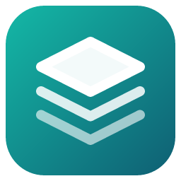

<h1 align="center">OneStop</h1>

Everything your friends make (apps, WoW addons, Foundry VTT modules, game mods and tools), installed and kept up to date in one Windows app.

## Install

1. Open the **[latest release](../../releases/latest)** and download `OneStop_x.y.z_x64-setup.exe`.
2. Run it. If Windows says **"Windows protected your PC"**, click **More info → Run anyway** (the installer
   isn't code-signed).
3. OneStop finds World of Warcraft and Foundry VTT by itself. Press **Get** on anything you want.

OneStop updates itself and everything you install. It lives in the tray (by the clock), so updates keep
coming while its window is closed.

## What's in this repo

- `registry.json`: the publishers OneStop shows (each has their own catalog)
- `catalog.json` + `icons/`: Jagger's projects
- Releases: the OneStop installer and `latest.json`, which installed copies check for updates

Want to publish your own projects in OneStop? Ask Jagger for the publishing guide.
